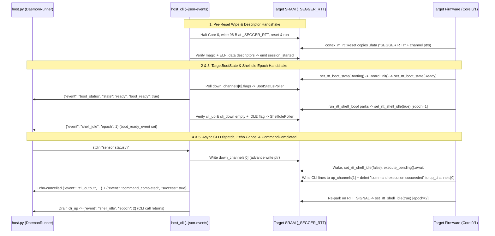

# Embedded Logging, Tracing & Host Diagnostic Tools

## Architectural Purpose
To provide deterministic, zero-allocation structured telemetry on embedded targets and robust host tooling for real-time firmware debugging, filesystem inspection, and RTT tracing.

---

## Core Invariants

### 1. Embedded Logging Standards
* **defmt Instrumentation**: Instrument all async tasks, controller loops, state machine transitions, and application entry points using `defmt` logging macros (`defmt::info!`, `defmt::debug!`, `defmt::warn!`, `defmt::error!`) for startup, heartbeat ticks, and command processing.
* **No Format String Allocations**: Never use standard library formatting (`format!`, `println!`) in target firmware. All logging formats must be resolved statically via `defmt` symbol tables to minimize Flash consumption and runtime execution overhead.

### 2. Consolidated Tracing Facade & Domain-Scoped Trace Modes
* **Platform Facade**: Always use the consolidated tracing facade module `use crate::tracing;` (which re-exports `platform::tracing`).
* **No External Tracing Crate**: Do NOT import the standard crates.io `tracing` crate directly in target code, as it requires dynamic heap allocation (`alloc`) and runtime string buffers incompatible with bare-metal `no_std` constraints.
* **Instrument Skip Rules & Domain Tagging**: When annotating methods with `#[tracing::instrument]`, do NOT list `self` in the `skip(...)` attribute. Annotate sensor peripheral/controller methods with `#[tracing::instrument(domain = "sensor")]` (and future audio paths with `domain = "audio"`) so `PERF` mode (`--features trace-perf`) captures all non-sensor execution spans and CPU usage while excluding sensor spans, whereas `SENSOR` mode (`--features trace-sensors`) emits real-time measured sensor reports only (`platform::tracing::trace_sensor_report`) with zero span overhead.
* **Target Selection, `TRACE` Tab & External Viewers (`Perfetto` vs `Rerun`)**: `tools/host.py` embeds `FirmwareTraceMode` (`None`, `Sensor`, `Perf`, `Audio`) in `.program_metadata`, streams structured `HostCliEvent::Trace` records into the **`TRACE`** workstation tab (with a separate hovering bottom playback/zoom/filter trackbar), exports `.csv` and `.perfetto.json` files to disk, opens **`PERF`** traces in `ui.perfetto.dev` (**🚀 Open in Perfetto**), and streams **`SENSOR`** / **`AUDIO`** traces directly into Rerun via `rerun-sdk` (**🚀 Open in Rerun** / `python tools/host.py trace open-rerun`).

### 3. Host Diagnostic & Debugging Tooling
* **Filesystem Inspection (`tools/host_fs` / `cargo host-fs`)**: Host-based Flash filesystem debugging, sequential storage inspection, directory tree walks, and raw partition read/write operations must be performed using `tools/host_fs`:
  ```bash
  # List files in sequential flash storage:
  cargo host-fs --elf target/thumbv6m-none-eabi/debug/cat_detector_app ls

  # Export telemetry to CSV:
  cargo host-fs --elf target/thumbv6m-none-eabi/release/cat_detector_app export-telemetry telemetry.csv

  # Decode crash logs:
  cargo host-fs --elf target/thumbv6m-none-eabi/release/cat_detector_app crash-log
  ```
* **Console Bridge & RTT Streaming (`tools/host_cli` / `cargo host-cli`)**: Host-based interactive CLI shell interaction, Real-Time Transfer (RTT) log streaming, defmt decoding, structured NDJSON event streaming (`--json-events`), and live event tracing must be performed using `tools/host_cli`:
  ```bash
  # Direct RTT shell console:
  cargo host-cli --elf target/thumbv6m-none-eabi/debug/cat_detector_shell

  # Attach concurrently to active host_debug non-halting RTT memory bridge (:50000):
  cargo host-cli --gdb-bridge 127.0.0.1:50000 --elf target/thumbv6m-none-eabi/debug/cat_detector_shell

  # Query current target firmware boot status across any binary without resetting:
  cargo host-cli boot-status --elf target/active_target.elf --json
  python tools/host.py boot-status --json
  ```
* **Target GDB Server, Symbol Resolver & USB Probe Status (`tools/host_debug` / `cargo host-debug`)**: Subcommand CLI (`serve`, `resolve`, `probe-status`) providing the dual-core `probe-rs` GDB RSP server (`:3333` Core 0, `:3334` Core 1), `:50000` non-halting RTT bridge, DWARF breakpoint resolution, and non-resetting USB probe availability inspection managed by `tools/host.py`:
  ```bash
  cargo host-debug serve --elf target/thumbv6m-none-eabi/debug/cat_detector_shell --gdb-core0-port 3333 --gdb-core1-port 3334
  cargo host-debug resolve --elf target/thumbv6m-none-eabi/debug/cat_detector_shell Reset_Handler app/src/cat_detector_shell.rs:102
  cargo host-debug probe-status --json
  ```
* **Host Daemon & Live Target Synchronization (`tools/host.py`)**:
  ```bash
  # Launch workstation daemon:
  python tools/host.py --target thumbv6m-none-eabi --package cat_detector --bin cat_detector_shell --release

  # Trigger incremental compilation, probe-rs flashing, and RTT reconnection without daemon restart:
  python tools/host.py sync

  # Query sync status:
  curl -s http://127.0.0.1:8899/api/sync/status
  ```
* **Target Flashing & Automated Bringup**:
  ```bash
  # Flash diagnostic shell via probe-rs:
  probe-rs download target/thumbv6m-none-eabi/debug/cat_detector_shell --chip RP2040

  # Flash production application:
  cargo run --target thumbv6m-none-eabi --package cat_detector --bin cat_detector_app

  # Execute automated target device test & bringup suites (or --debug for VS Code debugpy attach):
  conda run -n firmware-env python tools/host.py test
  conda run -n firmware-env python tools/host.py test --stress-runs 10
  conda run -n firmware-env python tools/host.py test -k tof_proximity --debug
  conda run -n firmware-env python tools/host.py test --script tools/device_tests/suites/test_cat_detector_bringup.py --manual
  ```
  See [CLI Tools, Flashing, Host Daemon & Verification Workflows](cli_and_workflows.md#6-interactive-symbolic-test--target-debugging-vs-code) for full VS Code `debugpy`, `CodeLLDB`, `node --test`, `probe-rs`, and `Cortex-Debug` symbolic debugging configurations.
* **VCS Workstation & Issue Matrix (`tools/forge.py`)**: Smartlog DAG inspection, commit splitting/combining, code reviews, and worm tracking are conducted via `tools/forge.py` (System Shock 2 - Xerxes workstation). Launch via `python tools/forge.py` (native pywebview desktop window), `python tools/forge.py --eel` (Chromium app mode), or `python tools/forge.py --no-browser` (headless).

---

## 4. Host-Target RTT Handshaking Protocols

Because Real-Time Transfer (RTT) operates asynchronously over shared target SRAM (`_SEGGER_RTT` in `platform/src/system/rtt.rs`) read and written non-intrusively over SWD (`probe-rs` or `host_debug`'s `:50000` memory bridge), the host (`tools/host_cli`, `tools/host_debug`, and `tools/host.py`) and target firmware coordinate through **six deterministic, lock-free handshakes** rather than fragile console-prompt string matching or binary-name heuristics:

### Overview Table

| # | Handshake | Shared State / Channel | Producer -> Consumer | Purpose |
| :--- | :--- | :--- | :--- | :--- |
| **1** | **Pre-Reset Wipe & `.data` Descriptor Verification** | `_SEGGER_RTT` header (`96 B`) + ELF `.data` | Host (`--reset`) <-> `cortex_m_rt::Reset` | Prevents latching stale pre-reset SRAM ring-buffer pointers when switching binaries or resetting |
| **2** | **Control-Flag Sideband Word** | `_SEGGER_RTT.down_channels[0].flags` (`u32`) | Target MCU -> Host (`host_cli`) | Encodes SEGGER mode (`[1:0]`), `RTT_SHELL_IDLE_FLAG` (`[8]`), `TargetBootState` (`[10:9]`), and 16-bit idle `epoch` (`[31:16]`) in a single 32-bit SWD read |
| **3** | **Universal Boot-Readiness (`TargetBootState`)** | `flags[10:9]` (`Reset` / `Booting` / `Ready` / `Faulted`) | All target binaries -> `BootStatusPoller` / `boot-status` CLI | Signals boot completion (or panic fault) uniformly across every firmware binary (`cat_detector_app`, `cat_detector_shell`, `carrier_board_shell`) |
| **4** | **Interactive Shell Idle & Prompt Epoch** | `flags[8]` + `flags[31:16]` + `cli_up`/`cli_down` empty | `run_rtt_shell_loop!` -> `ShellIdlePoller` | Emits `HostCliEvent::ShellIdle { epoch }` strictly once per prompt cycle after all TX/RX ring buffers drain |
| **5** | **SPSC Ring-Buffer Flow Control, Echo Cancellation & `CommandCompleted`** | `Up 0` (`defmt`), `Up 1` (`cli`), `Down 0` (`cli`) | Bidirectional (`host_cli` <-> `ShellController`) | Lock-free `(read, write)` ring-buffer handoff, dual-core `SIO.SPINLOCK31` + `SeqCst` (`dmb sy`) `defmt` framing, host echo cancellation, and post-`await` command completion |
| **6** | **SWD Bridge Multiplexing & GDB Step-Priority Yielding** | TCP `:50000` (`m`/`M`/`X` RSP) + `gdb_priority_until_ms` | `host_debug` (`:3333`/`:3334` <-> `:50000`) | Shares one USB SWD session between dual-core GDB and `host_cli` while yielding `:50000` polls during active GDB single-stepping |

### `_SEGGER_RTT.down_channels[0].flags` Bitfield Layout (`platform/src/system/rtt.rs`)

Bits `0..=1` are reserved by the SEGGER RTT specification for the ring-buffer blocking mode (`MODE_NON_BLOCKING_TRIM = 1`). Upper bits (`2..=31`) are ignored by standard SEGGER RTT readers and carry atomic single-writer (MCU `Release`) / single-reader (host SWD) lifecycle state:

```text
 31                           16 15     11 10          9      8  7           2 1       0
+-------------------------------+---------+-------------+------+--------------+---------+
|   16-bit Wrapping Idle Epoch  | Reserved| Boot State  | Idle |   Reserved   | RTT Mode|
|     (RTT_SHELL_EPOCH_SHIFT)   |  (0)    | (0..=3)     | Flag |     (0)      | (0..=2) |
+-------------------------------+---------+-------------+------+--------------+---------+
```

* **`bits [1:0]` (`RTT_CHANNEL_MODE_MASK = 0x3`)**: SEGGER RTT channel mode (`1 = MODE_NON_BLOCKING_TRIM`). Preserved across all flag updates.
* **`bit [8]` (`RTT_SHELL_IDLE_FLAG = 1 << 8`)**: `1` when `run_rtt_shell_loop!` has drained `down_channels[0]` and is parked on `RTT_SIGNAL.wait().await`; cleared to `0` immediately upon waking to process bytes or run an async command.
* **`bits [10:9]` (`RTT_BOOT_STATE_MASK = 0x3 << 9`, `TargetBootState`)**:
  * `0` (`Reset`): Initial zeroed / pre-init state prior to task entry.
  * `1` (`Booting`): Bootstrap task entered; `Board::init` and peripheral/controller setup in progress.
  * `2` (`Ready`): All board peripherals and Core 0 / Core 1 tasks initialized (`bootstrap_task` complete or shell loop entered).
  * `3` (`Faulted`): Asserted immediately on panic entry inside `platform::panic_handler::handle_panic_with_sizes` (also clears `RTT_SHELL_IDLE_FLAG`).
* **`bits [31:16]` (`RTT_SHELL_EPOCH_SHIFT = 16`)**: Unsigned 16-bit wrapping counter incremented (`wrapping_add(1)`) on every `!was_idle -> idle` transition so the host distinguishes consecutive prompts even when no console text was printed.

### Detailed Handshake Walkthroughs

#### 1. Pre-Reset Control-Block Wipe & ELF `.data` Verification (`tools/host_cli/src/rtt.rs`)
On warm resets or cross-binary reflashes (e.g., switching from `cat_detector_app` to `cat_detector_shell`), SRAM retains the previous image's `"SEGGER RTT"` header during the ~5–30 ms window while RP2040 `boot2` and `cortex_m_rt::Reset` copy `.data` from XIP Flash into SRAM. To eliminate stale-pointer races:
1. When `--reset` is requested, `host_cli` halts Core 0, writes `RTT_RESET_WIPE_BYTES` (`96` zero bytes) over `_SEGGER_RTT` in SRAM (`core.flush()`), and then issues `core.reset()` + `core.run()`.
2. `parse_rtt_channels` rejects `_SEGGER_RTT` (retrying every `100 ms`) until:
   - Bytes `[0..10]` match `b"SEGGER RTT"`.
   - `max_up_channels` (`1..=16`) and `max_down_channels` (`<= 16`) are within bounds and every named channel has a non-null `buffer_ptr` and `0 < size <= 1 MiB`.
   - When `_SEGGER_RTT` resides in an initialized ELF `.data` section (`read_elf_addr`), the live SRAM channel `(name_ptr, buffer_ptr, size)` words match the compiled ELF's `.data` descriptors byte-for-byte.

#### 2. Universal Firmware Boot-Readiness Handshake (`TargetBootState` & `boot-status`)
Every firmware binary calls `platform::rtt::set_rtt_boot_state(TargetBootState::Booting)` at task start and `set_rtt_boot_state(TargetBootState::Ready)` once initialization finishes:
* **Streaming (`host_cli --json-events`)**: `BootStatusPoller` inspects the same `down_channels[0].flags` word read on each poll tick (zero extra SWD transactions) and emits `{"event": "boot_status", "state": "ready", "boot_ready": true, ...}` whenever `TargetBootState` changes. `DaemonRunner.start_rtt_streaming` unblocks `boot_ready_event` directly from `boot_status` / `shell_idle` without inspecting binary names.
* **On-Demand CLI / HTTP (`boot-status`)**: `cargo host-cli boot-status --elf target/active_target.elf --json` and `python tools/host.py boot-status --json` (`GET /api/boot_status`) read `_SEGGER_RTT.down_channels[0].flags` non-intrusively (via `--gdb-bridge` when `host_debug` is active, or direct SWD `probe-rs` without resetting).

#### 3. Interactive Shell Idle, Echo Cancellation & Async Command Completion
Interactive CLI commands (`python tools/host.py cli <cmd>` and the workstation **CLI** console) combine three coordinated signals so multi-line async hardware commands never race or truncate output:
1. **Down-Channel Write & Echo Cancellation**: `host_cli` writes `<cmd>\n` into `down_channels[0]` (advancing `write` modulo `size`) and records the normalized `\r\n` bytes in `sent_buffer`; `cancel_echo` strips target `embedded-cli` character echo from `up_channels[1]` before `CliChunkParser` emits `HostCliEvent::CliOutput` lines (discarding `\x1b[2K` prompt redraws).
2. **Post-`await` `CommandCompleted` Event (`defmt` Up 0)**: When a command is dispatched, `embedded-cli` clears its prompt (`\x1b[2K`) *before* `ShellController::execute_pending().await` runs. `ShellController` logs `command execution succeeded` (or `command execution failed: <err>`) over `defmt` strictly *after* the async handler finishes, which `host_cli` emits as `HostCliEvent::CommandCompleted { success, error, device_ts }`.
3. **Post-Drain `ShellIdle` Epoch (`flags` on Down 0)**: Once `execute_pending().await` returns and `run_rtt_shell_loop!` re-parks on `RTT_SIGNAL.wait().await`, the target sets `RTT_SHELL_IDLE_FLAG` with `epoch + 1`. `ShellIdlePoller` waits until *both* `cli_up.is_empty()` and `cli_down.is_empty()` hold before emitting `HostCliEvent::ShellIdle { epoch }`, guaranteeing `DaemonRunner._collect_cli_output` has already consumed every trailing output line.

#### 4. Dual-Core `defmt` Serialization & `:50000` GDB Step-Priority Yielding
* **Dual-Core `defmt` Memory Barrier (`platform/src/telemetry/logger.rs`)**: On asymmetric/symmetric dual-core MCUs (e.g. RP2040 where `SIO.SPINLOCK31` lives on single-cycle IOPORT rather than the AHB-Lite SRAM bus), `RttProtocol::acquire()` and `release()` pair hardware spinlock acquisition with `core::sync::atomic::fence(Ordering::SeqCst)` (`dmb sy`) and guard crash-ring writes with `try_borrow_mut()` so concurrent Core 0 + Core 1 `PERF` span frames never interleave or panic in `up_channels[0]`.
* **`:50000` RTT Bridge Yielding During GDB Stepping (`tools/host_debug/src/server.rs`)**: When `host_debug` serves both GDB (`:3333`/`:3334`) and `host_cli --gdb-bridge 127.0.0.1:50000`, each GDB single-step (`s`, `vCont;s`, `vCont;r`) stamps `gdb_priority_until_ms` (`250 ms` window). Background `:50000` RTT memory polls sleep `40 ms` while that window is active so SWD bandwidth is dedicated to sub-second source-line stepping.


