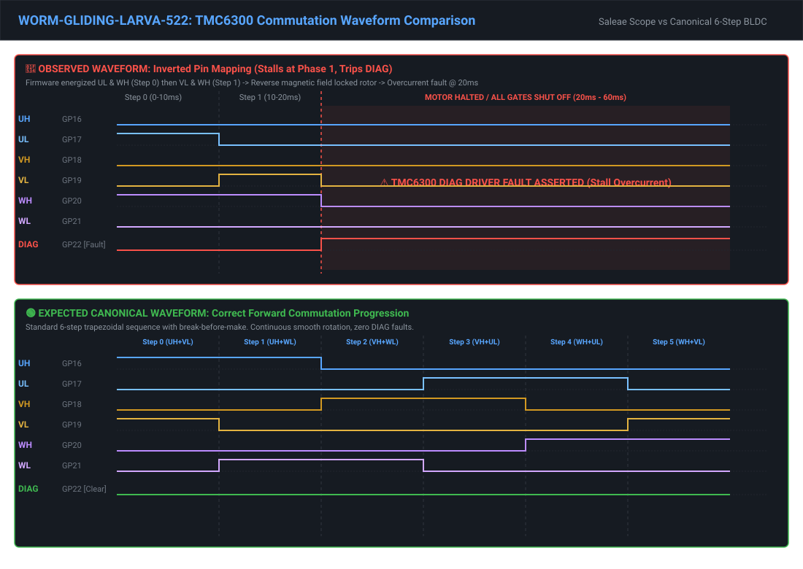

# 🟢 `[WORM-GLIDING-LARVA-522]` Motor fails, DIAG light pops on

- **UUID**: `e023aead-8cae-4353-8468-bbebaad4385d`
- **ID**: `WORM-GLIDING-LARVA-522`
- **Status**: `RESOLVED`
- **Severity**: `MEDIUM`
- **Category**: `FIRMWARE`
- **Component**: `target`
- **Created**: `2026-10-18 00:37:14 UTC`
- **Resolved**: `2026-10-18 01:10:06 UTC`

#### Description

The DIAG light is still popping on. It looks like we still cannot escape commutation phase 1. Please see attached scope trace.

#### Reproduction Steps

1. motor speed 100

#### Waveform Analysis & Scope Comparison



##### 1. Observed Output Waveform (`attachments/WORM-GLIDING-LARVA-522/digital.csv`)
- **Step 0 ($t = 0.00\,\text{ms} \to 10.00\,\text{ms}$)**: Firmware energized **UL** (GP17) and **WH** (GP20).
- **Step 1 ($t = 10.00\,\text{ms} \to 19.89\,\text{ms}$)**: Firmware energized **VL** (GP19) and **WH** (GP20).
- **Fault ($t \approx 20\,\text{ms}$)**: High-side driver held WH continuously across both steps while switching low sides in reverse polarity. The resultant reverse magnetic stator flux locked the rotor against permanent magnets, driving coil current into saturation and asserting the hardware `DIAG` fault pin (GP22). The motor controller caught the fault, transitioned state to `MotorState::Off`, and de-energized all gates.

##### 2. Expected Canonical Waveform (6-Step Trapezoidal BLDC)
- **Step 0 ($t = 0 \to 10\,\text{ms}$)**: **UH** (GP16) & **VL** (GP19) active; Phase W floating.
- **Step 1 ($t = 10 \to 20\,\text{ms}$)**: **UH** (GP16) & **WL** (GP21) active; Phase V floating.
- **Step 2 ($t = 20 \to 30\,\text{ms}$)**: **VH** (GP18) & **WL** (GP21) active; Phase U floating.
- **Step 3 ($t = 30 \to 40\,\text{ms}$)**: **VH** (GP18) & **UL** (GP17) active; Phase W floating.
- **Step 4 ($t = 40 \to 50\,\text{ms}$)**: **WH** (GP20) & **UL** (GP17) active; Phase V floating.
- **Step 5 ($t = 50 \to 60\,\text{ms}$)**: **WH** (GP20) & **VL** (GP19) active; Phase U floating.
- **DIAG (GP22)**: Remains low throughout operation; motor accelerates smoothly with continuous commutation.

#### Execution / Console Logs

```text
[] [daemon] [INFO] [Sync] Target synchronized & RTT connected successfully.
[] [daemon] [INFO] RTT streaming process connected
[] [target] [INFO] 0.001520 INFO [platform::core_monitor] MPU stack guard configured at 0x2003c000
[] [target] [INFO] 0.021760 INFO [platform::core_monitor] MPU stack guard configured at 0x2000c500
[] [target] [INFO] 0.001606 INFO [platform::core_monitor] MPU stack guard configured at 0x2003c000
[] [target] [INFO] 0.019319 INFO [peripheral::max17048] Reset detected (RI set). Initializing ModelGauge and triggering Quick-Start.
[] [target] [INFO] 0.022348 INFO [platform::core_monitor] MPU stack guard configured at 0x2000c500
[] [daemon] [INFO] [Sync] Compiling target firmware...
[] [daemon] [INFO] Building target firmware: package=cat_detector, bin=cat_detector_shell, target=thumbv6m-none-eabi, release=True
[] [build] [INFO]     Finished ]8;;https://doc.rust-lang.org/cargo/reference/profiles.html#default-profiles\`release` profile [optimized + debuginfo]]8;;\ target(s) in 0.25s
[] [daemon] [INFO] Target binary built successfully: /Users/<username>/gh/firmware/target/thumbv6m-none-eabi/release/cat_detector_shell
[] [daemon] [INFO] [Sync] Compiling host utilities (host_cli, host_fs)...
[] [daemon] [INFO] Building host utilities: host_cli and host_fs
[] [build] [INFO]     Finished ]8;;https://doc.rust-lang.org/cargo/reference/profiles.html#default-profiles\`release` profile [optimized + debuginfo]]8;;\ target(s) in 0.26s
[] [daemon] [INFO] Host tools ready: cli=/Users/<username>/gh/firmware/target/release/host_cli, fs=/Users/<username>/gh/firmware/target/release/host_fs
[] [daemon] [INFO] RTT stream disconnected
[] [daemon] [INFO] [Sync] Flashing target device via probe-rs...
[] [daemon] [INFO] Flashing target via cargo run: package=cat_detector, bin=cat_detector_shell, target=thumbv6m-none-eabi
[] [flash] [INFO]     Finished ]8;;https://doc.rust-lang.org/cargo/reference/profiles.html#default-profiles\`release` profile [optimized + debuginfo]]8;;\ target(s) in 0.08s
[] [flash] [INFO]      Running `/Users/<username>/gh/firmware/tools/runner.sh target/thumbv6m-none-eabi/release/cat_detector_shell --dump`
[] [flash] [INFO]     Finished ]8;;https://doc.rust-lang.org/cargo/reference/profiles.html#default-profiles\`release` profile [optimized + debuginfo]]8;;\ target(s) in 0.18s
[] [flash] [INFO]      Finished in 7.48s
[] [flash] [INFO] RTT connected. Active channels:
[] [flash] [INFO]   - Up Channel: "defmt" (logs)
[] [flash] [INFO]   - Up Channel: "cli" (raw output)
[] [flash] [INFO]   - Down Channel: "cli" (raw input)
[] [flash] [INFO] shell> 
[] [flash] [INFO] 
[] [flash] [INFO]        |\      _,,,---,,_
[] [flash] [INFO]  Zzz   /,`.-'`'    -.  ;-;;,_
[] [flash] [INFO]       |,4-  ) )-,_. ,\ (  `'-'
[] [flash] [INFO]      '---''(_/--'  `-'\_)  
[] [flash] [INFO] Type 'help' to print usage.
[] [flash] [INFO] shell> Draining buffered defmt logs:
[] [flash] [INFO] 0.001490 INFO MPU stack guard configured at 0x2003c000
[] [flash] [INFO] 0.021743 INFO MPU stack guard configured at 0x2000c500
[] [flash] [INFO] Error: unexpected EOF during frame decoding (possible target/ELF mismatch or truncated log buffer)
[] [daemon] [INFO] Flash download succeeded via cargo run
[] [daemon] [INFO] [Sync] Starting RTT streaming channels...
[] [daemon] [INFO] [Sync] Target synchronized & RTT connected successfully.
[] [daemon] [INFO] RTT streaming process connected
[] [target] [INFO] 0.001468 INFO [platform::core_monitor] MPU stack guard configured at 0x2003c000
[] [target] [INFO] 0.021734 INFO [platform::core_monitor] MPU stack guard configured at 0x2000c500
[] [daemon] [INFO] Target bug created: WORM-SLICK-FIREWORM-677 (Error: unexpected EOF during frame decoding (possible target/ELF mismatch or truncated log buffer) RTT connected. Active channels:) with 1 attachments
[] [target] [INFO] motor speed 1038.030879 INFO [controller::shell_controller] received command "Motor { subcommand: Some(Speed), arg1: Some(\"100\"), arg2: None, arg3: None, partition: None }"
[] [target] [INFO] 38.031166 INFO [controller::shell_controller] command execution succeeded
[] [target] [INFO] 38.035467 WARN [controller::motor_controller] Warning, calibration is not present! Running with fallback limits.
[] [target] [INFO] 38.035511 INFO [controller::motor_controller] Starting motor...
[] [target] [INFO] shell> 38.057941 ERROR [peripheral::tmc6300] TMC6300 PIO DIAG pin asserted: driver fault detected
[] [target] [INFO] 38.057971 INFO [controller::motor_controller] Stopping motor...
```

#### Attachments & References

| Type | Filename | Description |
| :--- | :--- | :--- |
| `log` | [target_system_logs_WORM-GLIDING-LARVA-522.log](attachments/WORM-GLIDING-LARVA-522/target_system_logs_WORM-GLIDING-LARVA-522.log) | Target system and defmt logs from host daemon session |
| `document` | [digital.csv](attachments/WORM-GLIDING-LARVA-522/digital.csv) | Attached document (digital.csv) |

#### Resolution Notes

Root cause identified: Inverted TMC6300 pin mapping and phase masks from commit 1a7ef379 caused firmware to energize UL and WH in Step 0 and VL and WH in Step 1, creating reverse magnetic fields that locked the rotor, causing stall overcurrent and tripping TMC6300 DIAG fault pin at t = 20 ms. Restored canonical pin assignments (UH=16, UL=17, VH=18, VL=19, WH=20, WL=21) and canonical 6-step trapezoidal commutation masks across board, peripheral driver, and codegen. Added waveform comparison preview under recordings/previews/waveform_gliding_larva_522.svg and codified regression unit tests in peripheral/tests/integration.rs and tools/tests/test_worm_gliding_larva_522_commutation_phase_progression.py.
